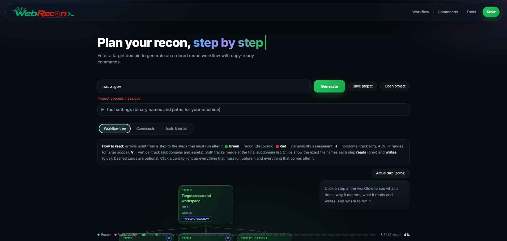
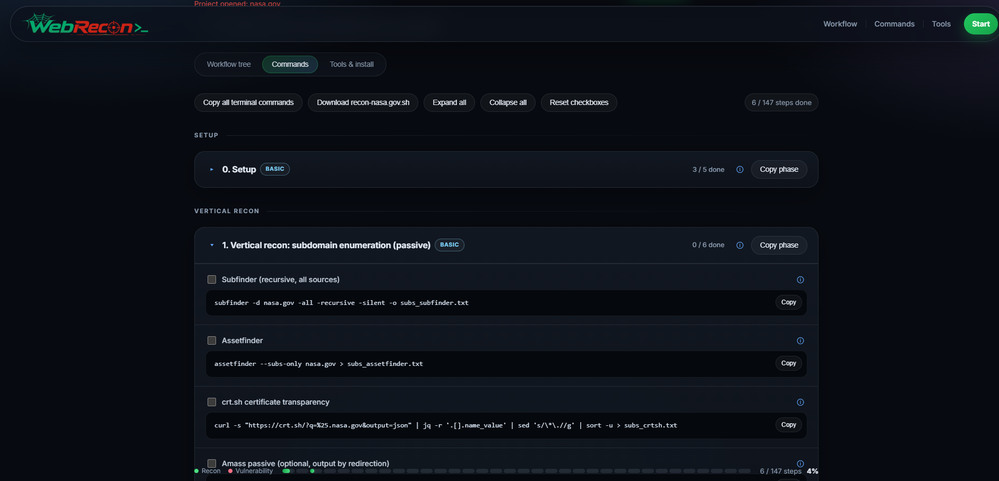
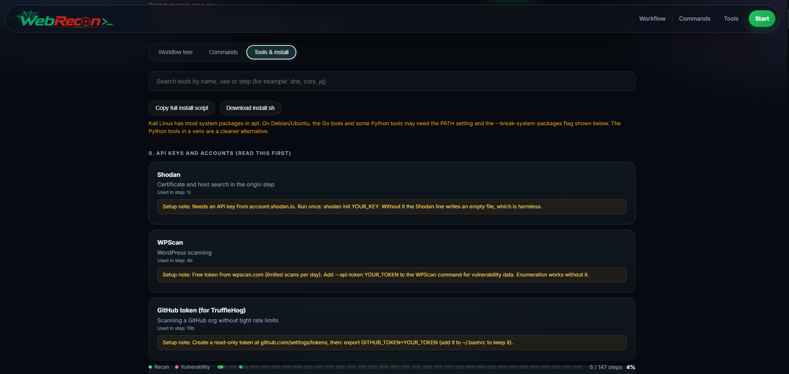
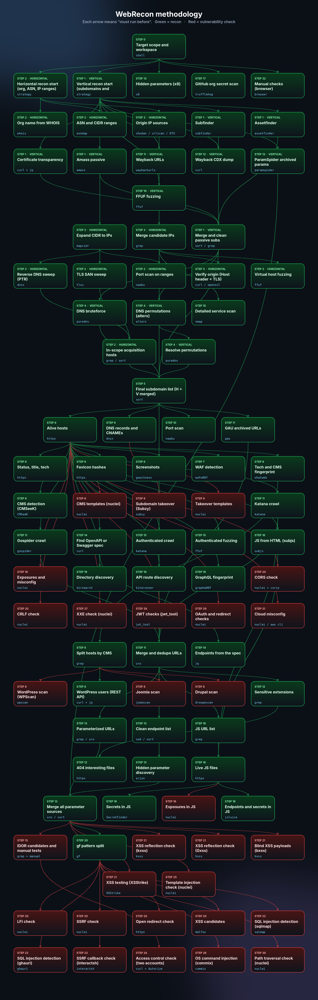

<p align="center">
  
</p>

<h3 align="center">Recon, planned step by step.</h3>


<p align="center">
  Enter one domain. Get an ordered recon workflow with copy-ready commands, expected results,<br>
  a visual attack-surface map and progress tracking. Built for bug bounty hunters and web pentesters.
</p>

<p align="center">
  
</p>

<h2 align="center">Start your recon. <sub>Stop guessing.</sub></h2>

<p align="center">
  ✅ <b>Ordered workflow</b> from subdomains to vulnerability checks<br>
  ✅ <b>Copy-ready commands</b> with every flag explained<br>
  ✅ <b>Progress you can trust</b>, saved per target
</p>

<p align="center">
  🌐 <a href="https://webrecon.xyz"><b>webrecon.xyz</b></a>
</p>

<p align="center">
  <a href="https://webrecon.xyz"></a>
  
  
  
  
</p>

<p align="center">
  <a href="#-why-webrecon">Why</a> ·
  <a href="#-key-features">Features</a> ·
  <a href="#-the-attack-surface-map">Map</a> ·
  <a href="#-the-phases">Phases</a> ·
  <a href="#-responsible-use">Responsible use</a> ·
  <a href="#-connect">Connect</a>
</p>

---

## ✨ Why WebRecon

Recon is where most bug bounty and pentest work begins, and it is easy to lose the thread: dozens of tools, hundreds of output files, and no clear answer to "what should I run next?"

WebRecon gives you a **method**, not a pile of commands.

> **One domain in → one ordered workflow out.** Every command is built for your target, every step tells you what good looks like, and nothing runs without you.

---

## 🚀 Key features

| | Feature | What it gives you |
|:-:|---|---|
| 🗺️ | **Visual attack-surface map** | A live tree of 95 steps. Horizontal and vertical tracks merge into one list. Click any step to see its purpose, inputs and outputs. |
| ⌘ | **Copy-ready commands** | Copy one command, a whole phase, or the full script (`.sh`) in one click. |
| 🎯 | **Expected results** | Every output file has a *good looks like*, an *if empty* and a *next step* note. |
| 🔎 | **Flag explanations** | The ⓘ icon next to a command explains each flag in plain language. |
| 🟢🔴 | **Recon vs. vulnerability cards** | Green for discovery, red for vulnerability checks, so you always know which phase you are in. |
| 📊 | **Segmented progress bar** | One segment per phase, filled as you go, with a glow when everything is done. |
| ✅ | **Checkboxes per domain** | Progress is saved in your browser for each target. |
| 💾 | **Save and open projects** | Export your domain, settings and progress as one JSON file. Auth headers are never saved. |
| 🧰 | **Tools and install guide** | Install commands, setup notes, API key guidance and a search box for all 70 tools. |
| 🔐 | **Authenticated testing** | Paste your own test-account header once, and logged-in crawling and checks use it. |
| 📱 | **Works on any screen** | Wide workflow on desktop, scaled map with a details panel on phones. |

---

## 📸 Screens

<p align="center">
  
  
  
</p>

## 🗺️ WebRecon methodology

This is the real workflow from the site: 95 steps, drawn from the same data the tool uses.

<p align="center">
  
</p>


<details>
<summary><b>Show the same map as plain text</b></summary>

```text
🎯 Target domain
└── 0  Setup (check tools, create workspace)
    ├── 1  Vertical recon ─ subdomains
    │   └── 4  DNS bruteforce + permutations ──┐
    ├── 2  Horizontal recon ─ ASN, CIDR, IPs ──┤
    │                                          ▼
    │                           6  Final subdomain list
    │                                          │
    │                                          ▼
    │                           7  Live hosts
    │                           ├── 8   WAF · CMS detection
    │                           ├── 10  Subdomain takeover   🔴
    │                           ├── 17  JavaScript recon
    │                           └── 12  URL collection
    │                                    └── 14 Parameters
    │                                         ├── 21 gf candidates  🔴
    │                                         │    ├── XSS           🔴
    │                                         │    ├── SQL injection 🔴
    │                                         │    ├── SSRF          🔴
    │                                         │    └── Command inj.  🔴
    │                                         └── Access control    🔴
    └── …  (95 steps in total)
```

</details>

---

## 🧭 The phases

| Track | Phases | What it finds |
|---|---|---|
| 🟢 **Discovery** | Setup → Final list → Live hosts | Subdomains, DNS, origin IPs, live hosts, WAF and CMS |
| 🟢 **Content** | URLs, sensitive files, parameters, API, auth, JavaScript, GitHub | Endpoints, hidden parameters, exposed files, secrets |
| 🔴 **Vulnerability checks** | Takeover, exposures, gf candidates, XSS, SQLi, SSRF, access control, SSTI, command injection, XXE, JWT, OAuth, traversal and upload | Candidates to test by hand, each with a proof step |
| ⚪ **Wrap-up** | Cloud misconfiguration, manual checks, summary | Buckets, browser checks, file counts |

Every phase has a short *why it matters*, *what you should get* and *run this after* note.

---

## 🛠️ Built with

Plain HTML, CSS and JavaScript in a single file. No build step, no framework, no backend, and no account. Your domains and progress stay in your browser.

---

## ⚠️ Responsible use

WebRecon only generates commands. Running them is your responsibility.

- Test only **in-scope** targets, systems you own, or targets you have **written permission** to test.
- Read the program **rules** first. Some forbid scanning or credential testing.
- Use **your own test accounts**. Never access or change another user's data.
- Never run **brute force**. Keep request rates low and stop if a service struggles.
- Report findings through the program's official channel.

---

## 🗓️ Roadmap

- [ ] Mark every command as tested against a lab target
- [ ] More vulnerability classes (request smuggling, prototype pollution)
- [ ] Markdown report draft from completed steps
- [ ] Shareable project links

---

## 🤝 Contributing

Ideas, corrections and new tools are welcome. For a wrong flag or command, a pull request with the tool version you tested is the most useful thing you can send.

---

## 🔗 Connect

[](https://github.com/0xmun1r)
[](https://facebook.com/0xmun1r)
[](https://t.me/AccessXConnectBot)
[](https://youtube.com/@0xmun1r?si=BQwwz7HA2YfqKvaF)

🌐 Website: [webrecon.xyz](https://webrecon.xyz)

---

## 📄 Disclaimer and licence

WebRecon is provided as is, without warranty. You are responsible for the commands you run and for having permission to test any target. Third-party tools are separate projects with their own licences.

Licence: **MIT**. See the [LICENSE](LICENSE) file.

<p align="center"><sub>Made for the hunters who like to know where they are going. 🕸️</sub></p>
